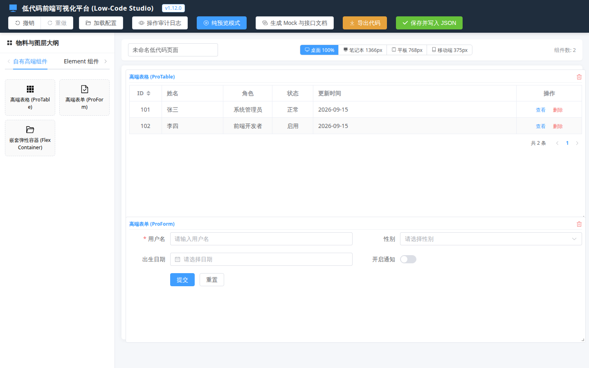
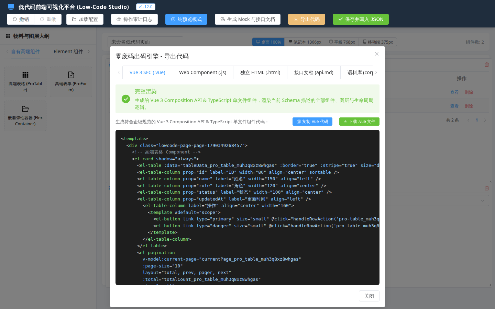
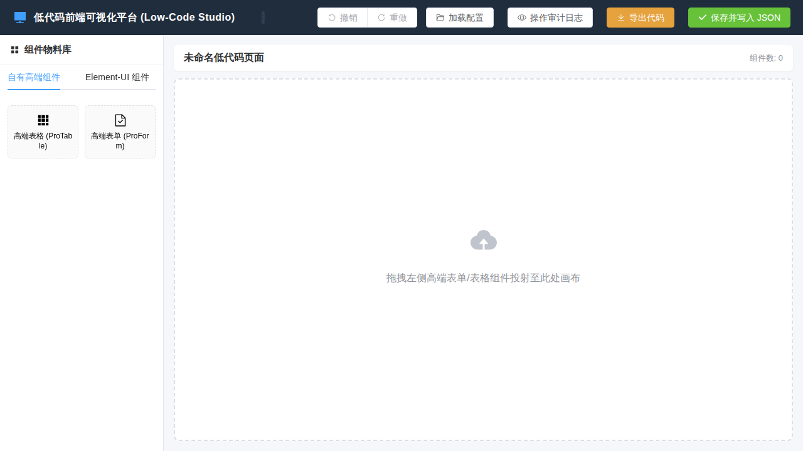

# 低代码前端可视化平台

拖拽搭页面，再导出成能运行的前端代码。当前版本 **v2.11.0**。

页面在设计器里是一份 JSON Schema。表格、表单和按钮都由这份 Schema 渲染。导出时，同一份 Schema 生成 Vue 单文件组件、独立 HTML，以及由这两种组件组成的语料库。平台不生成后端业务代码。页面 JSON 存在本地文件里，SQLite 只记操作日志。

文档与范围：**[docs/README.md](docs/README.md)** · 红绿线 **[spec-red-green-lines.md](docs/spec-red-green-lines.md)**

---

## 界面一览

左侧物料、中间栅格画布、顶栏预览 / Mock / 导出 / 保存（拖入高端表格与表单后的典型画布）。



<p align="center"><sub>设计器主画布</sub></p>

<table>
  <tr>
    <td width="50%" valign="top">
      
      <p align="center"><sub>多目标出码（Vue / WC / HTML）</sub></p>
    </td>
    <td width="50%" valign="top">
      
      <p align="center"><sub>纯预览（无搭建控件）</sub></p>
    </td>
  </tr>
</table>

更多界面截图（属性抽屉、语料库、Mock 文档等）见 **`docs/assets/`**：`form-config.png`、`corpus.png`、`api-doc.png`。

---

## 能做什么

- **拖拽搭页面**：网格画布上拖入、缩放、对齐。物料包括高端表格、高端表单，以及按钮、输入框、卡片、标签、警告、开关、分割线。
- **改配置而不是改代码**：列、表单项、显隐条件、页面初始状态和事件动作都写在 Schema 里。
- **出三种前端产物**：Vue 3 单文件组件、配套的 Web Component，以及用 CDN 就能打开的 HTML。
- **导出语料库**：`corpus.jsonl` 里每个页面各有一条 Vue 记录和一条 HTML 记录。
- **对接已有接口**：组件绑定 `apiBinding` 后，设计器和导出页面都用浏览器 `fetch` 取数。没有地址时可以生成 Mock，并附上接口文档。
- **页面可以收尾**：改标题、保存、载入、删除、恢复上一份备份。撤销和重做覆盖拖拽和属性修改。
- **生成即物料（自我循环）**：画布上选中任意组件组，一键打包为自定义物料；物料可拖拽复用、导出自描述代码（Vue / HTML 内嵌物料定义）、再导入还原——平台能消化自己生成的产物。
- **黑盒物料与版本管理**：物料可打包为"黑盒"（带 inputs/outputs 契约与不可变版本）。实例锁定具体版本、显式升级/回滚；发布新版本、差异对比、归档、fork、批量升级实例一应俱全。
- **设计器体验（v2.2.0）**：分栏属性栏（选中不挡画布）、真组件画布、可视可选网格、Schema JSON 可编、Spacer、ProForm 逐项宽高；Element Plus 可画布物料覆盖；草稿契约编辑与 major 发布确认。
- **设计器手势与反馈（v2.3.0）**：节点条网格 ±、右键/双击开属性、常驻快捷键提示、Props+Attrs 合并、数据源 Tab 置末、拖拽淡网格可见、表格行操作友好提示。
- **本地保存**：Schema 写到 `backend/storage/pages/*.json`。保存、删除和恢复记在 SQLite。

管道编排、远程物料、协同和登录不在当前版本里：复杂能力见 v3.0，企业级见 v4.0（`docs/roadmap/`）。

### 🔜 规划中的核心能力（详见 `docs/`）

- **Component - API - Event (CAE) 三角解耦模型**：REST 数据源、最小动作链、物料黑盒引用与版本契约已实现；GraphQL、Event Flow Orchestrator 归 **v3.0**。
- **数据与事件管道编排 (Pipeline Orchestration)**：生命周期管道、页面路由跳转 — **v3.0**。
- **物料市场 / 远程物料 SDK / Module Federation / 可视化逻辑流** — **v3.0**（[`3.0.0_PLAN.md`](docs/roadmap/3.0.0_PLAN.md)）。
- **多人协同 / RBAC / SSO / 分布式存储 / CI/CD** — **v4.0**（`4.0.0_PLAN.md` 尚未编写）。

---

## 🎯 核心理念与范围边界 (Core Principles & Scope Guardrails)

> **单一事实源**：严格红绿线与冻结纪律见 [`docs/spec-red-green-lines.md`](docs/spec-red-green-lines.md)；文档总索引见 [`docs/README.md`](docs/README.md)。  
> **本节是 README 摘要**：新增功能前先对照。**任何不服务于核心命题的功能都属于过度扩展。**

### 一句话核心命题

**把可视化搭出来的页面，变成结构清晰、可运行、可再次被平台消化的前端代码。**

### 四条核心理念

1. **JSON 是唯一事实来源 (Single Source of Truth)** —— 画布、属性、事件、数据源、图层全部是一份可序列化 Schema；一切能力都必须能落到 Schema 上，且 Schema 可往返（保存 / 载入 / 出码 / 导入）。
2. **产物可运行、可读、可往返** —— 导出的是能直接跑的 Vue / HTML，不是不可读的中间产物；导出物自描述（内嵌 `@lowcode-material`），可被平台重新导入，即平台能"消化"自己的产物。
3. **零废码、不写后端业务代码** —— 平台只做前端可视化与出码；不生成后端业务逻辑，不做运行时黑盒引擎（表达式走受限解释器，绝不 `eval` / `new Function`）。
4. **安全与容错默认开启** —— 受限表达式白名单、DOMPurify、Zod 落盘校验、原子写 + 写队列、悬空引用安全跳过；任何落盘 / 导入 / 渲染都不应让页面崩溃。

### 核心功能（必须护住的护城河）

| 能力                                                                 | 归属      |
| :------------------------------------------------------------------- | :-------- |
| 拖拽画布 + 物料（内置 + 自定义）                                     | v1.x      |
| 属性 / 事件动作链 / 数据源绑定                                       | v1.x      |
| 多目标出码（Vue SFC / Web Component / HTML）+ 语料库                 | v1.x      |
| 自我循环物料（打包 / 自描述导出 / 导入还原）                         | v2.0      |
| 黑盒引用 + 契约 (inputs / outputs)                                   | v2.1      |
| 物料版本管理（草稿 / 不可变发布 / 锁定 / 升级 / 回滚 / 差异 / fork） | v2.1      |
| 本地持久化 + SQLite 审计 + 引用保护                                  | v1.x–v2.1 |

### 结构债务与冻结（摘要）

- **三轮 16 项核心债务**（v2.4–v2.8）已全部收口；改造前快照与测试增量见 **[`docs/implemented/CORE_DEBT_ROUNDS.md`](docs/implemented/CORE_DEBT_ROUNDS.md)**。
- **红线 / 冻结线 / PR 五问** 以 **[`docs/spec-red-green-lines.md`](docs/spec-red-green-lines.md)** 为单一事实源（含 v3/v4 归属与锦上添花清单）。
- **版本节奏**：`2.x` 只做护城河打磨；`3.x` 物料生态与编排；`4.x` 企业协同 —— 详见 **[`docs/roadmap/README.md`](docs/roadmap/README.md)**。

---

## 🏗️ 架构设计哲学 (Architecture)

### 1. JSON 桥梁模型 (The JSON Bridge Concept) ✅

平台通过监听用户的拖拉拽与属性配置操作，实时构建并维护一个可序列化的 **JSON 树**。JSON 既是视图渲染的凭证，也是连接组件、接口与事件的唯一桥梁。

核心属性 Key 规范：

- `id`: DOM ID 与画布节点的全局唯一标识。✅
- `component`: 对应的 UI 组件 / 物料类型。✅
- `name`: 对应的表单项属性 / 数据绑定 Key。🟡 (基础表单字段已用)
- `click`: 点击事件动作链（刷新数据、开关弹窗、消息、写入 state）。✅
- `functions`: 对应作用域/域下的逻辑处理函数与业务脚本。🔜 规划中

### 2. Component - API - Event (CAE) 三角解耦模型 🟡 最小闭环 + 物料黑盒/版本已落地

> 组件渲染、`apiBinding` 数据源和 click 动作链已经接通。GraphQL、可视化流程编排和完整管道仍按下方蓝图演进。

```text
                     +----------------------------------+
                     |        页面全局状态中枢          |
                     |       (Pinia / Reactive State)   |
                     +----------------------------------+
                                ▲            │
             状态监听 / 参数映射  │            │ 驱动重新渲染 / 属性透传
                                │            ▼
       +--------------------------------------------------------------+
       |                                                              |
       |  【组件层: Component Node】  ◄───────  【接口层: API Data】  |
       |  - ProTable (高端表格)                 - RESTful / GraphQL   |
       |  - ProForm (高端表单)                  - JSON Path 提取      |
       |  - Element UI 元素                      - 入参 / 出参转换     |
       |                                                              |
       +--------------------------------------------------------------+
                                ▲            │
                       抛出事件  │            │ 执行动作链
                      (Event)   │            ▼ (Action Chain)
                       +--------------------------------+
                       |   【事件动作层: Event/Action】  |
                       |   - Event Trigger              |
                       |   - Action Dispatcher          |
                       |   - Event Flow Orchestrator    |
                       +--------------------------------+
```

---

## 🛠️ 技术栈选型

| 层级               | 技术选型              | 版本/组件        | 说明                                               |
| :----------------- | :-------------------- | :--------------- | :------------------------------------------------- |
| **前端框架**       | Vue 3                 | `3.5+`           | Composition API 及 `<script setup>` 范式           |
| **UI 组件库**      | Element Plus          | `2.x`            | 企级 UI 物料与高端表单/表格（按需引入）            |
| **拖拽布局引擎**   | vue3-grid-layout-next | `1.x`            | 基于栅格网格的可伸缩拖拽布局插件                   |
| **状态管理**       | Pinia                 | `4.x`            | 响应式 Store，管理设计器全局 Schema 状态           |
| **前端构建**       | Vite                  | `8.x`            | 极速冷启动与 HMR 构建工具（rolldown 内核）         |
| **表达式求值**     | 自研受限解释器        | —                | `{{ }}` 表达式安全求值（拒绝 eval / new Function） |
| **HTML 消毒**      | DOMPurify             | `3.x`            | 自定义 HTML 写入 iframe 文档前消毒                 |
| **后端运行环境**   | Node.js               | `20+` / `22+`    | JavaScript 运行环境（CI 覆盖 20 与 22）            |
| **后端 Web 框架**  | Express               | `4.x`            | RESTful API 服务框架                               |
| **Schema 校验**    | Zod                   | `4.x`            | 页面 Schema 落盘前结构强校验与字段长度限制         |
| **JSON 文件存储**  | Node File System      | `fs/promises`    | 持久化存储 Schema JSON 配置文件                    |
| **日志数据库**     | SQLite                | `better-sqlite3` | 本地轻量级审计日志数据库                           |
| **共享类型与工具** | `@lowcode/shared`     | —                | Monorepo 共享：类型 + 少量纯函数（如 jsonPatch）   |
| **单元测试**       | Vitest                | `4.x`            | 前端与后端：Store / 出码 / 表达式 / 数据源 / 存储  |
| **代码规范**       | ESLint + Prettier     | `10.x` / `3.x`   | 0 error / 0 warning，统一代码风格                  |
| **CI/CD**          | GitHub Actions        | —                | 双 Node 版本：typecheck → lint → test → build      |
| **工程化 & 规范**  | TypeScript            | `6.x`            | 前后端与 shared 使用同一主版本                     |

---

## 📂 项目工程目录结构

```text
low-code-platform/
├── .github/workflows/      # GitHub Actions CI（typecheck → lint → test → build）
├── docs/                   # 文档集
│   ├── implemented/        # 技术规范 (CAE/物料/组件 I/O/管道编排) 与优化报告
│   └── roadmap/            # 各版本规划与路线图 (0.x ~ 4.0.0)
├── shared/                 # @lowcode/shared（共享类型 + jsonPatch 等纯工具，前后端共用）
│   └── src/                # index.ts（共享类型）+ jsonPatch.ts（统一 JSON Patch 实现）
├── frontend/               # Vue 3 前端低代码设计器工程
│   ├── src/
│   │   ├── components/     # 设计器 UI（CanvasContainer, MaterialList, PropertyDrawer ... + drawer/ app/ canvas/ 子面板）
│   │   ├── registry/       # 内置物料种子 (materials.ts) + 运行时注册表 (materialRegistry.ts) + 节点类型 (nodeTypes.ts)
│   │   ├── stores/         # Pinia 全局设计器 Store (designerStore.ts)
│   │   ├── composables/    # useCanvasGrid / useDesignerHotkeys / useDrawerNode
│   │   ├── utils/          # 出码门面 (codeGenerator.ts) + codegen/ 多目标生成器 / 物料 (materialPacker, materialImport, materialResolver, materialInject) / 表达式 / 数据源
│   │   ├── types/          # 类型 re-export（统一来自 @lowcode/shared）
│   │   ├── *.test.ts       # Vitest 单元测试（Store / 出码 / 物料循环 / 版本解析 ...）
│   │   └── App.vue         # 主应用与 API 联调界面
│   ├── .env / .env.example # VITE_API_BASE 环境变量
│   ├── eslint.config.js    # ESLint flat config（vue + TS + prettier 协调）
│   ├── vitest.config.ts
│   ├── package.json
│   └── vite.config.ts      # unplugin 按需引入 + vendor 分包
├── backend/                # Node.js + Express 后端服务工程
│   ├── src/
│   │   ├── controllers/    # Schema CRUD / 物料与版本控制器 (materialController.ts)
│   │   ├── middleware/     # X-Api-Key 认证
│   │   ├── db/             # SQLite logs.db 初始化脚本
│   │   ├── services/       # 存储 (storageService/materialService/materialVersionService) + 引用扫描 / 批量升级
│   │   ├── utils/          # JSON Patch 审计差异 + 版本判定 (versionClassify.ts)
│   │   ├── validation/     # Zod 落盘强校验 (schemaValidation.ts / materialValidation.ts)
│   │   └── server.ts       # Express 服务入口
│   ├── storage/            # JSON 文件持久化存储目录
│   │   ├── pages/          # 页面配置 JSON 集合 (*.json)
│   │   ├── components/     # 组件配置 JSON 集合 (*.json)
│   │   └── materials/      # 物料目录：<id>/{manifest.json, draft.json, versions/<v>.json}
│   ├── data/               # SQLite 数据库存储目录 (logs.db)
│   ├── eslint.config.mjs   # ESLint flat config（TS + prettier 协调）
│   ├── package.json
│   └── tsconfig.json
├── package.json            # Root Monorepo 脚本（build / test / lint / typecheck）
└── README.md
```

---

## 🚀 快速开始与开发指南

### 1. 安装依赖

```bash
# 在项目根目录下安装所有 Workspaces 依赖
npm install
```

> **Node 版本**：建议使用 **Node 20 LTS**（`package.json` `engines.node >=20`）。Node 22 上若本机未装 Visual Studio C++ 工作负载，`better-sqlite3` 可能无法编译原生模块；可用 `nvm use 20` 后再安装。

### 2. 启动开发服务器

```bash
# 启动后端 REST API 服务 (运行于 http://localhost:3001)
npm run dev:backend

# 启动前端 Vite 低代码设计器 (运行于 http://localhost:5173)
npm run dev:frontend
```

### 3. 构建与打包

```bash
# 对前端与后端同时进行 TypeScript 类型检查与生产编译打包
npm run build
```

### 4. 质量检查（CI 同款命令）

```bash
npm run typecheck   # 前后端类型检查
npm run lint        # ESLint（0 error / 0 warning 门槛）
npm run test        # Vitest：前端 247 项 + 后端 104 项
npm run format      # Prettier 全仓格式化
```

---

## 🔌 后端 RESTful API 接口定义

| 请求方式   | 路径                       | 描述                                                                                          | 参数 / Body                                                                                          |
| :--------- | :------------------------- | :-------------------------------------------------------------------------------------------- | :--------------------------------------------------------------------------------------------------- |
| **GET**    | `/api/schemas`             | 获取页面/组件 JSON 列表                                                                       | `?type=page` 或 `?type=component`                                                                    |
| **GET**    | `/api/schemas/:id`         | 读取指定 ID 的 Schema 内容                                                                    | `?type=page`                                                                                         |
| **POST**   | `/api/schemas`             | 保存 Schema 至本地 `.json` 文件并记录 SQLite 日志（落盘前 Zod 结构强校验 + 脚本字段长度上限） | Body: `PageSchema` JSON 对象                                                                         |
| **PATCH**  | `/api/schemas/:id`         | 增量保存：对已存 Schema 应用 RFC 6902 JSON Patch，Zod 校验后落盘并记录审计差异                | Body: `{ "ops": JsonPatchOp[], "baseVersion"?: string }`（`baseVersion` 乐观并发校验，不符返回 409） |
| **DELETE** | `/api/schemas/:id`         | 删除 Schema 配置文件并记录 SQLite 日志                                                        | `?type=page`                                                                                         |
| **GET**    | `/api/logs`                | 查询 SQLite 操作审计日志                                                                      | `?pageId=xxx` (可选)                                                                                 |
| **GET**    | `/api/schemas/:id/backups` | 列出该 Schema 的备份代数                                                                      | `?type=page`                                                                                         |
| **POST**   | `/api/schemas/:id/restore` | 从指定备份代恢复                                                                              | Body: `{ "index": 1 }`                                                                               |

### 物料与版本管理 (v2.0 / v2.1)

| 请求方式   | 路径                                  | 描述                                                     | 参数 / Body                                    |
| :--------- | :------------------------------------ | :------------------------------------------------------- | :--------------------------------------------- |
| **GET**    | `/api/materials`                      | 物料清单（兼容 v2.0 单文件与 v2.1 目录结构）             | —                                              |
| **POST**   | `/api/materials`                      | 注册物料；携带 `contract` 的黑盒物料走目录结构并发布首版 | Body: `MaterialManifest`                       |
| **GET**    | `/api/materials/:id`                  | 物料详情                                                 | —                                              |
| **DELETE** | `/api/materials/:id`                  | 删除物料（被引用时返回 409，需 `?force=true`）           | `?force=true` (可选)                           |
| **GET**    | `/api/materials/:id/refs`             | 引用计数与引用页面列表                                   | —                                              |
| **PUT**    | `/api/materials/:id/draft`            | 保存草稿（编辑态，不产生版本）                           | Body: `MaterialVersion`                        |
| **DELETE** | `/api/materials/:id/draft`            | 丢弃草稿                                                 | —                                              |
| **GET**    | `/api/materials/:id/versions`         | 版本列表（版本号 / 发布时间 / 契约签名 / 引用数）        | —                                              |
| **POST**   | `/api/materials/:id/versions`         | 发布：草稿 → 不可变版本（服务端判定建议版本号）          | Body: `{ draft, suggestedVersion? }`           |
| **GET**    | `/api/materials/:id/versions/:v`      | 指定版本详情                                             | —                                              |
| **GET**    | `/api/materials/:id/versions/:v/diff` | 两版本差异（契约层 + 结构层）                            | `?base=:b`                                     |
| **DELETE** | `/api/materials/:id/versions/:v`      | 归档版本（当前版本不可归档，被引用需 `?force=true`）     | `?force=true` (可选)                           |
| **POST**   | `/api/materials/:id/rollback`         | 回滚：历史版本设为当前                                   | Body: `{ "version": "1.0.0" }`                 |
| **POST**   | `/api/materials/:id/fork`             | 从指定版本派生新物料                                     | Body: `{ fromVersion, newType, label, icon }`  |
| **POST**   | `/api/pages/upgrade-material`         | 批量升级：改写页面中引用某物料旧版本的实例               | Body: `{ materialId, fromVersion, toVersion }` |

配置了环境变量 `API_KEY` 后，以上接口要求请求头 `X-Api-Key`。`CORS_ORIGIN` 默认 `http://localhost:5173`，`HOST` 默认 `127.0.0.1`。

`VITE_API_KEY` 会打进前端包，只适合挡住对本机端口的随意扫描，不能当作用户口令或服务端机密。未配置 `API_KEY` 时接口保持开放，方便本地开发。

---

## 🗓️ 近期维护收口

| 版本 | 主题 | 文档 |
|------|------|------|
| v2.11.0 | 画布快捷键 `handleDesignerKeydown` 可测化 | [2.11.0_PLAN.md](docs/roadmap/2.11.0_PLAN.md) |
| v2.10.0 | 工厂 + `useDrawerNode` 单测 | [2.10.0_PLAN.md](docs/roadmap/2.10.0_PLAN.md) |
| v2.9.0 | `catch` 口径 + 拆分模块单测 | [2.9.0_PLAN.md](docs/roadmap/2.9.0_PLAN.md) |
| v2.4–v2.8 | 三轮结构债务（16 项） | [CORE_DEBT_ROUNDS.md](docs/implemented/CORE_DEBT_ROUNDS.md) |

---

## 📝 版本变更历史 (Changelog)

### 📌 v2.11.0 (2026-11) — 画布快捷键逻辑单测

- 将快捷键处理从 `useDesignerHotkeys` 抽到 `designerKeydown.ts`，监听注册仍由 composable 负责，**用户可见行为不变**。
- 新增 `designerKeydown.test.ts`：门禁、`Delete`、撤销、方向键步长（含 Shift×2）。

### 📌 v2.10.0 (2026-11) — 工厂与抽屉 composable 单测

- **`designerNodeFactory` 扩测**：覆盖 `createBlackBoxNode`（materialRef + pin）、`instantiateCompositeSnapshot`（平移 + id 重写/空快照）、`createLayer`（dialog/loading/custom-html 可见性与默认 props）。
- **`useDrawerNode` 单测**：`formatEventPath` 与 `selectedNode` 响应式联动。
- **文档**：新增 [`2.10.0_PLAN.md`](docs/roadmap/2.10.0_PLAN.md)。

### 📌 v2.9.0 (2026-11) — 维护性与文档收口

- **`catch` 口径统一**：生产路径中剩余未标注类型的 `catch` 全部改为 `unknown`（与 v2.8.0 已清零的 `catch (err: any)` 对齐）；出码字符串模板内 `catch (err)` 为生成 JavaScript，不计入 TypeScript 口径。
- **拆分模块单测**：新增 `designerSchema` / `designerState` / `designerNodeFactory` 与 `useMaterialIO` / `useMaterialVersions` 单测，覆盖主画布同源、版本 IO 与导入路径。
- **文档**：[`docs/roadmap/2.9.0_PLAN.md`](docs/roadmap/2.9.0_PLAN.md) 含任务验收与 CI 自测表（T1–T4 全部 ✅）。

### 📌 v2.4.0 – v2.8.0

结构债务三轮 16 项已全部收口（出码拆分、Patch 保存与历史、并发 PATCH、类型/`catch`、表达式分层、巨型文件拆分等）。**条目级复盘**见 [`CORE_DEBT_ROUNDS.md`](docs/implemented/CORE_DEBT_ROUNDS.md)；**发布纪要**见 [`docs/roadmap/README.md`](docs/roadmap/README.md) 中对应 `*_PLAN.md`。

### 📌 v2.0.0 – v2.3.0

自我循环物料、黑盒契约与版本线、设计器分栏与手势体验 —— 能力说明仍见上文「能做什么」；实施细节见 `2.0.0`–`2.3.0` 的 roadmap 与 [`implemented/`](docs/implemented/README.md) 物料规范。

### 📌 v0.0.1 – v1.12.0

基础拖拽、多图层、数据源与动作链、Mock/语料库、工程化与安全基线等。**按版本浏览**请打开 **[`docs/roadmap/README.md`](docs/roadmap/README.md)**（semver 总表 + 各 `*_PLAN.md` / `*_IMPLEMENTATION.md`）。

---

## 📄 文档索引 (Documentation Index)

| 入口 | 内容 |
|------|------|
| **[docs/README.md](docs/README.md)** | 文档中心：分区地图、读者路径 |
| **[spec-red-green-lines.md](docs/spec-red-green-lines.md)** | 红绿线 · 范围裁决（**PR 前必读**） |
| **[spec-doc-conventions.md](docs/spec-doc-conventions.md)** | 命名、文首元数据、修订纪律 |
| **[implemented/README.md](docs/implemented/README.md)** | 技术规范一览（CAE / 物料 / I/O / 结构债务档案） |
| **[roadmap/README.md](docs/roadmap/README.md)** | **版本总表**（0.0.1 → 4.0，含 v2.9 维护） |

当前发布线：**v2.11.0**；维护记录见 **[v2.11.0_PLAN.md](docs/roadmap/2.11.0_PLAN.md)**。
